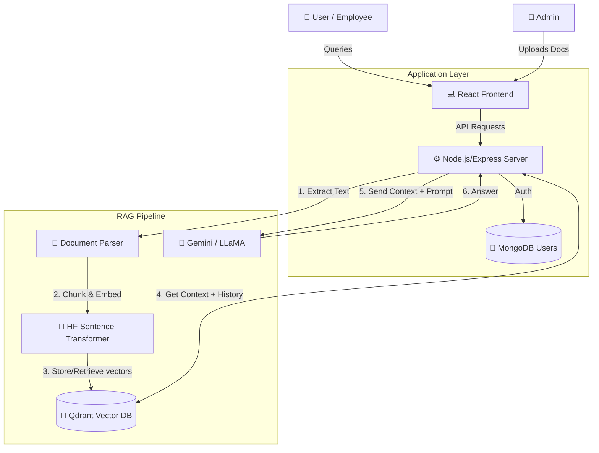

<div align="center">

# 🚀 WOFO.AI
### Enterprise-Grade Offline-Capable RAG Knowledge Assistant
**Secure. Private. Offline. Intelligent.**

[](https://opensource.org/licenses/MIT)
[](https://nodejs.org/)
[](https://github.com/your-org/wofo-ai)
[](https://reactjs.org/)
[](https://www.docker.com/)
[](https://qdrant.tech/)
[](https://deepmind.google/technologies/gemini/)

<br/>


<br/>

[Features](#-key-features) • [Architecture](#-architecture) • [Tech Stack](#-tech-stack) • [Installation](#-installation-setup) • [API](#-api-documentation) • [Contributors](#-contributors)

</div>

---

## 📖 Overview

**WOFO.AI** is a state-of-the-art **Retrieval-Augmented Generation (RAG)** system engineered for enterprises. It allows organizations to securely ingest internal documentation—policies, technical manuals, legal contracts—and empowers employees to query this knowledge base using natural language.

Unlike public AI tools, **WOFO ensures total data privacy** by running a localized RAG pipeline where your sensitive data never leaves the controlled environment until it's processed for your specific query.

### Why WOFO?
- **� Offline & Air-Gapped Ready:** Can be deployed in completely disconnected environments using local LLMs.
- **�🔐 Enterprise Security:** Role-based access control (RBAC) ensures data is only accessible to authorized personnel.
- **🧠 Context-Aware AI:** Uses advanced vector embeddings to understand the *meaning* of your queries, not just keywords.
- **⚡ High Performance:** Powered by **Qdrant** for millisecond-latency vector searches.
- **📂 Universal Ingestion:** Support for PDF, DOCX, TXT, and XLSX formats.

---

## ✨ Key Features

| Category | Features |
|----------|----------|
| **🧠 Intelligent Core** | • **RAG Pipeline**: Advanced retrieval system combining semantic search with LLM generation.<br>• **Smart Chunking**: Automatically processes and chunks documents for optimal context.<br>• **Hybrid AI Engine**: Switch between cloud models (Gemini) and **fully offline local models** (LLaMA/Mistral) for zero-data-leakage environments. |
| **🛡️ Security & Access** | • **Fully Offline Capable**: Run entirely on your local infrastructure without internet access.<br>• **Role-Based Access**: Granular permissions for Admins, Employees, and Users.<br>• **Data Isolation**: Enterprise-grade data separation protocols.<br>• **Secure Auth**: JWT-based authentication with encrypted password storage. |
| **⚡ Performance** | • **Vector Search**: High-speed similarity search using Qdrant (Runs Locally).<br>• **Scalable Architecture**: Dockerized services for easy horizontal scaling.<br>• **Optimized Backend**: Node.js & Express for non-blocking I/O. |
| **🖥️ User Interface** | • **Modern Dashboard**: React-based UI with Tailwind CSS.<br>• **Chat History**: Persistent conversation memory.<br>• **File Management**: Drag-and-drop uploads with real-time status. |

---

## 🏗 Architecture

The system follows a modular microservices-ready architecture:



---

## 🛠 Tech Stack

### **Frontend**
- **Framework:** React 18
- **Styling:** Tailwind CSS, FontAwesome
- **Animations:** Framer Motion
- **State/Routing:** React Router DOM

### **Backend**
- **Runtime:** Node.js
- **Framework:** Express.js
- **Database:** MongoDB (Metadata, Chat Logs), Qdrant (Vector Embeddings)
- **AI Integration:** `@google/generative-ai`, `@xenova/transformers`
- **File Processing:** `pdf-parse`, `mammoth`, `multer`

### **DevOps & Tools**
- **Containerization:** Docker
- **Version Control:** Git
- **API Testing:** Postman

---

## 🚀 Installation & Setup

Follow these steps to deploy WOFO locally.

### Prerequisites
- **Node.js** (v18+)
- **Docker Desktop** (for Qdrant)
- **MongoDB** (Local or Atlas URI)

### 1️⃣ Clone the Repository
```bash
git clone https://github.com/your-org/wofo-ai.git
cd wofo-ai
```

### 2️⃣ Backend Setup
```bash
cd backend
npm install
```

Create a `.env` file in the `backend` directory:
```env
PORT=5000
MONGO_URI=mongodb://localhost:27017/wofo_ai
JWT_SECRET=your_super_secret_key_here
GEMINI_API_KEY=your_google_gemini_api_key
```

### 3️⃣ Frontend Setup
```bash
cd ../frontend
npm install
```

### 4️⃣ Start Vector Database
Start Qdrant using Docker:
```bash
docker run -d -p 6333:6333 -p 6334:6334 \
    -v $(pwd)/qdrant_storage:/qdrant/storage:z \
    qdrant/qdrant
```

### 5️⃣ Run the Application
**Backend:**
```bash
# In backend terminal
npm start
# Server will run on http://localhost:5000
```

**Frontend:**
```bash
# In frontend terminal
npm start
# Client will open at http://localhost:3000
```

---

## 🔌 API Documentation

Detailed documentation is available in `backend/API_DOCUMENTATIONI.md`.

### Core Endpoints

| Method | Endpoint | Description |
|:---|:---|:---|
| `POST` | `/api/upload/ingestion` | **Ingest**: Upload PDF/DOCX, chunk, embed, and store in Qdrant. |
| `POST` | `/api/search/retrieval` | **Query**: Retrieve relevant context and generate an AI answer. |
| `POST` | `/api/chatbot/query` | **Chat**: Conversational endpoint with memory focus. |
| `GET` | `/api/files` | **List**: Get all uploaded documents (Admin). |

---

<div align="center">

**Built with ❤️ for the Future of Enterprise Knowledge by Ahad Dangarvawala**

</div>
